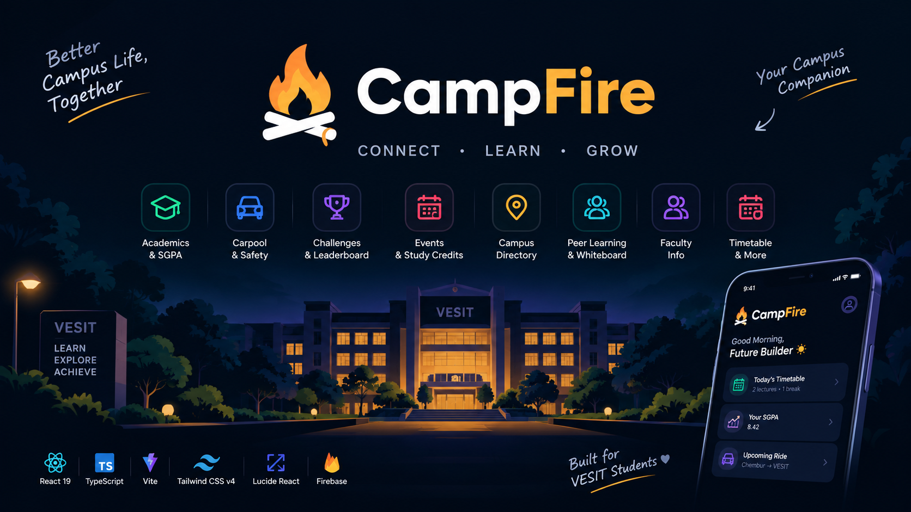
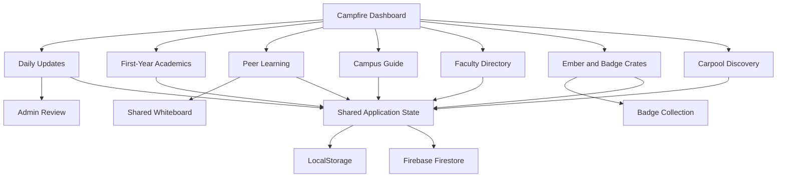

 <p align="center">
  
</p>

<h1 align="center">🔥 Campfire</h1>

<p align="center">
  <strong>Your campus. Your people. Your place.</strong>
  <br>
  Your all-in-one companion for navigating the first year of college.
</p>

<p align="center">
  
  
</p>

<p align="center">
  
  
  
  
  
  
</p>

---

## 🌐 About Campfire

**Campfire** is a Campus360 student companion built for **GENESIS 2.0, Problem Statement PS-02**, with VESIT, Chembur, Mumbai, as its campus reference.

College life is more than lectures. First-year students need to find classrooms, understand academics, connect with faculty, collaborate with peers, discover campus activities, and feel part of their college community.

Campfire brings these experiences together in one interactive platform, combining campus utilities with peer learning and gamified engagement.

## ✨ Features

### 🏠 Daily Updates

A centralized feed for what's happening around campus.

- Discover announcements, activities, and student-submitted posts.
- Submit proposals for events, hackathons, lost and found, and other campus activities.
- Submit general posts for administrative review.
- Approved submissions appear in the Daily Updates feed.

The admin approval workflow helps keep campus information organized and moderated.

### 📚 First-Year Academics

Academic resources curated around the needs of first-year engineering students.

- Organized first-year academic content.
- Learning resources to support coursework.
- SGPA calculation and academic planning tools.
- What-if grade simulations with target presets.
- Visual academic projections using Recharts.

### 🤝 1-to-1 Peer Learning

Learn together through individual peer-learning sessions.

- Connect with peers for academic help.
- Collaborate on a **shared interactive whiteboard**.
- Draw using pen, pencil, and marker tools.
- Adjust stroke thickness with small and large tips.
- Export the completed whiteboard as a PNG image.

The shared board makes it easier to explain concepts visually, solve problems, and preserve useful study notes.

### 🗺️ Interactive Campus Guide

Explore the campus through an interactive 2D map featuring the distinctive curved building layout.

- Interact with the campus map.
- Explore campus locations and facilities.
- Find important student spaces and classrooms.
- Navigate the campus more confidently.

### 🏛️ Faculty & Department Directory

Find the right people to contact when you need academic guidance or departmental assistance.

- **QUESTIT Cell — IT Department**
- **CodeCell ++ — CS Department**
- **CoLegion — AIDS Department**

Each section organizes relevant faculty members and important contacts, helping students identify whom to approach for queries, guidance, and department-related information.

### 🎁 Ember Economy & Badge Crates

A gamified reward system designed to encourage students to return and engage with Campfire.

- Receive **50 Ember on account creation**.
- Receive **5 Ember daily** to encourage regular participation.
- Open crates to collect campus badges.
- Discover badges across five rarity tiers:
  - Common
  - Rare
  - Legendary
  - Mythical
  - Unreal
- Explore different crate types: Daily, Bronze, Silver, and Golden.

Badge rarity is tied to the configured probability of obtaining each badge, making collection a continuing progression experience.

### 🚗 Student Carpool Discovery

Discover and coordinate student rides around campus.

- Interactive map powered by Leaflet and OpenStreetMap.
- Filter carpools by direction: To Campus or From Campus.
- View student verification status.
- Request available seats through a host approval workflow.

### 🔥 Campus Dashboard

A unified starting point for the student experience.

- Campus overview and daily information.
- Relevant recommendations and activity updates.
- Shared application state across connected modules.

---

## 🛠️ Technology Stack

Campfire aims to follow approximately **90% of the proposed technology stack**, adapting implementation details where necessary.

| Layer | Technology |
|---|---|
| Frontend | React 19 |
| Language | TypeScript |
| Build Tool | Vite |
| Styling | Tailwind CSS v4 |
| Icons | Lucide React |
| State Management | React Context |
| Client Persistence | LocalStorage |
| Backend & Database | Firebase Firestore |
| Maps | Leaflet, React Leaflet, OpenStreetMap |
| Charts | Recharts |
| Authentication Demo | SMTP + FireBase Auth Direct on Mail |

## 🏗️ Architecture



The application uses modular React features, shared state, and configured persistence to connect the student experience.

## 🔐 Authentication Status

The current demo generates a PIN and displays it within the application to demonstrate the verification flow.

- Actual email delivery is not yet implemented.
- Production email authentication and institutional student verification are planned.
- The current demo PIN flow is not production-grade authentication.

## 🚀 Getting Started

**Prerequisites:** Node.js, npm, and Git.

```bash
git clone <repo-url>
cd campfire
npm install
```

Configure the required environment variables in `.env` using `.env.example` as a reference, then start the application:

```bash
npm run dev
```

Create a production build with:

```bash
npm run build
```

Open the local URL printed by Vite.

## 🔮 Future Scope

- Production email authentication and VESIT student verification.
- Further improvements to peer-learning collaboration.
- Expanded campus resources and student engagement.
- Stronger server-side enforcement for rewards, bookings, and access control.

---

## 🏁 GENESIS 2.0

**Project:** Campfire — Campus360 Student Companion  
**Problem Statement:** PS-02 — One Companion for Every First-Year Need  
**Campus Reference:** VESIT, Chembur, Mumbai

<p align="center">
  <strong>Built for campus life. Designed for student connection. 🔥</strong>
</p>
